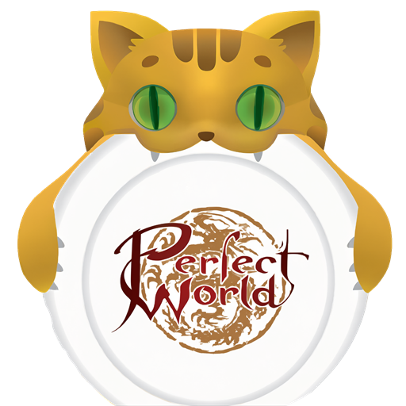
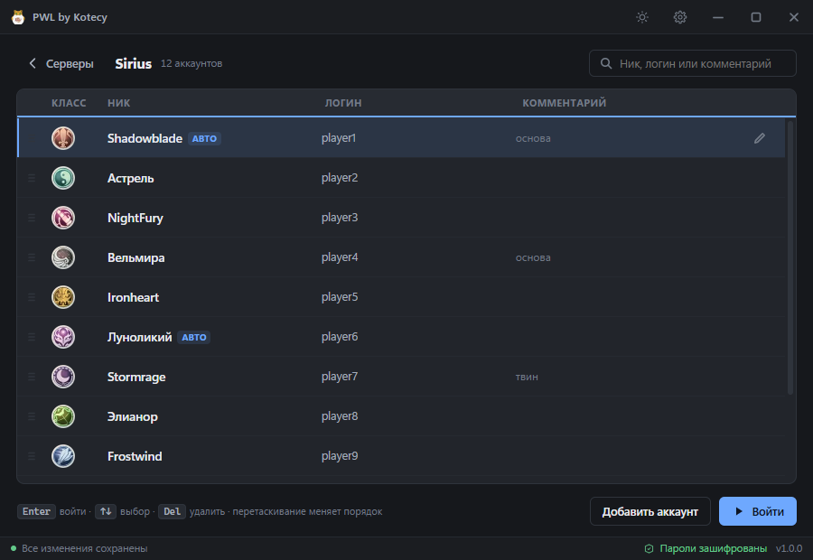
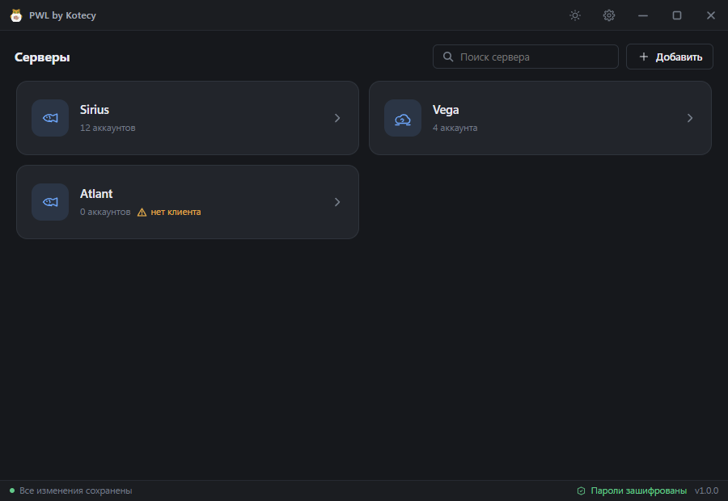
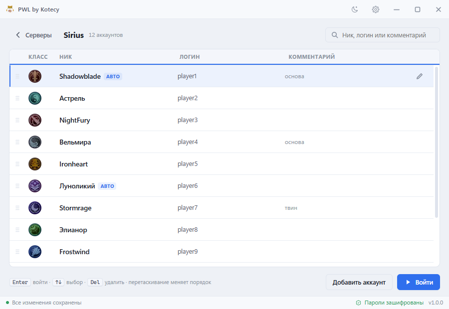

<div align="center">



# PWL by Kotecy

Лёгкий менеджер аккаунтов Perfect World: серверы, аккаунты и запуск игры в один клик.

[](CHANGELOG.md)
[](#установка)
[](#технологии)
[](LICENSE)

[Скачать](../../releases/latest) · [История версий](CHANGELOG.md) · [Разбор старой версии](AUDIT.md)

<br>



</div>

## Зачем это нужно

PWL хранит ваши серверы и аккаунты в одном месте и запускает `elementclient.exe` с нужным логином и паролем. Больше никаких блокнотов с паролями и ярлыков на каждый аккаунт.

- **Серверы и аккаунты.** Карточки серверов с эмблемами, поиск, контекстное меню. У сервера без пути к клиенту виден значок предупреждения, путь можно указать позже или в момент входа.
- **Вход в игру.** Кнопка «Войти» или `Enter` запускает клиент одним процессом и подставляет данные. Если запуск не удался, причина показывается в интерфейсе.
- **Удобный список.** Виртуальный список остаётся плавным на сотнях аккаунтов. Строки перетаскиваются для смены порядка, класс персонажа виден по иконке, у аккаунта есть комментарий и отметка «Авто» для автовхода на персонажа.
- **Пароли под защитой.** На Windows пароли шифруются системой (DPAPI) и привязаны к вашей учётной записи. В файле библиотеки открытого текста нет.
- **Две темы.** Светлая и тёмная, переключение волной от кнопки. Тема запоминается.
- **Трей.** По настройке кнопки «Свернуть» и «Закрыть» прячут окно в системный трей.
- **Перенос данных.** Библиотека версии 0.9.x подхватывается автоматически, исходные файлы остаются нетронутыми.

<p align="center">
  
  
</p>

## Установка

Установка не нужна: приложение — один файл.

1. Скачайте `PWL_*_x64.exe` из [последнего релиза](../../releases/latest).
2. Положите его в любую папку и запустите. Права администратора не требуются.
3. Если SmartScreen предупредит о неизвестном издателе, нажмите «Подробнее», затем «Выполнить в любом случае». Файл не подписан сертификатом.

Требования: Windows 10 или 11 (64 бита) и WebView2 Runtime. Он входит в состав Microsoft Edge, на актуальных системах уже установлен.

Обновление: закройте приложение и замените файл новым. Данные лежат отдельно, в `%APPDATA%\PWL`, и не затрагиваются. Удаление: удалите файл и, если нужно, папку с данными.

## Горячие клавиши

| Клавиши | Действие |
| --- | --- |
| `Ctrl+N` | Новый сервер или аккаунт, в зависимости от экрана |
| `Ctrl+F` | Поиск |
| `Ctrl+T` | Сменить тему |
| `↑` `↓` `PageUp` `PageDown` `Home` `End` | Перемещение по списку аккаунтов |
| `Enter` | Войти выбранным аккаунтом |
| `Delete` | Удалить выбранный аккаунт |
| `Esc` | Закрыть меню или окно, вернуться на предыдущий экран |

## Где хранятся данные

```
%APPDATA%\PWL\library.json       библиотека: серверы, аккаунты, настройки
%APPDATA%\PWL\library.json.bak   копия предыдущей записи
```

Папку можно открыть из настроек одним кликом. Данные пишутся атомарно: сначала временный файл, затем замена. Файлы версии 0.9.x в этой же папке не изменяются, поэтому на старую версию можно вернуться.

## Технологии

| Слой | Что используется |
| --- | --- |
| Ядро | Rust: домен, хранилище, миграция, план запуска. Крейт `crates/pwl-core` без GUI и платформенных зависимостей |
| Оболочка | Tauri 2 и WebView2: окно, трей, диалоги, DPAPI (`src-tauri`) |
| Интерфейс | HTML, CSS и ванильный JavaScript на ES-модулях, без сборщика и фреймворков |
| Сборка | Cargo, Tauri CLI, один самодостаточный exe, GitHub Actions |

Всё состояние держится в памяти, на диск пишется отложенно. Подробнее о том, чем это отличается от версии 0.9.x, и с цифрами замеров, в [AUDIT.md](AUDIT.md).

## Сборка из исходников

Понадобятся [Rust](https://rustup.rs) (stable), Node.js 20 или новее и Tauri CLI.

```powershell
cargo install tauri-cli --version "^2" --locked
cd src-tauri
cargo tauri build --no-bundle
```

Готовый файл появится по пути `src-tauri/target/release/pwl.exe`. Интерфейс вшит внутрь, рядом с ним ничего класть не нужно. Обычный `cargo build --release` без Tauri CLI не подойдёт: такой файл будет искать интерфейс на dev-сервере.

### Разработка

```powershell
cargo test -p pwl-core            # тесты ядра
cd tools; npm ci; cd ..           # зависимости утилит, нужны для смоук-теста и спрайтов
node tools/smoke-ui.mjs           # прогон интерфейса в DOM без браузера
node tools/build-assets.mjs       # проверка комплекта ui/ и контракта CSP
node tools/dev-server.mjs         # предпросмотр интерфейса: http://localhost:5173
cd src-tauri; cargo tauri dev     # приложение целиком
```

В браузере (`dev-server.mjs`) работает мок ядра с демо-данными: все действия настоящие, кроме запуска игры и кнопок окна.

### Выпуск релиза

1. Поднять версию в `src-tauri/tauri.conf.json`, `src-tauri/Cargo.toml` и `CHANGELOG.md`, обновить `RELEASE_NOTES.md`.
2. Создать тег и отправить его:
   ```powershell
   git tag v1.0.0
   git push origin v1.0.0
   ```
3. GitHub Actions соберёт `PWL_<версия>_x64.exe` и опубликует релиз с текстом из `RELEASE_NOTES.md`. Если тег не совпадает с версией в `tauri.conf.json`, сборка остановится с ошибкой.

## Структура проекта

```
PWL/
├── crates/pwl-core/       ядро: домен, хранилище, запись на диск, миграция, запуск
├── src-tauri/             оболочка Tauri: команды, состояние, трей, DPAPI
│   ├── capabilities/      права окна
│   └── tauri.conf.json    окно, CSP, параметры сборки
├── ui/
│   ├── index.html         все экраны и SVG-спрайт иконок
│   ├── styles/            темы, компоненты, экраны
│   ├── src/               модули интерфейса
│   └── assets/            спрайты классов, иконка заголовка
├── tools/                 dev-сервер, смоук-тест, генератор спрайтов
├── docs/screenshots/      снимки для README
├── .github/workflows/     тесты, сборка exe и публикация релиза
├── AUDIT.md               разбор версии 0.9.x и замеры
├── CHANGELOG.md
└── RELEASE_NOTES.md       текст для страницы релиза
```

## Лицензия

Проект распространяется под лицензией [MIT](LICENSE). PWL неофициальный и не связан с Perfect World Entertainment.
