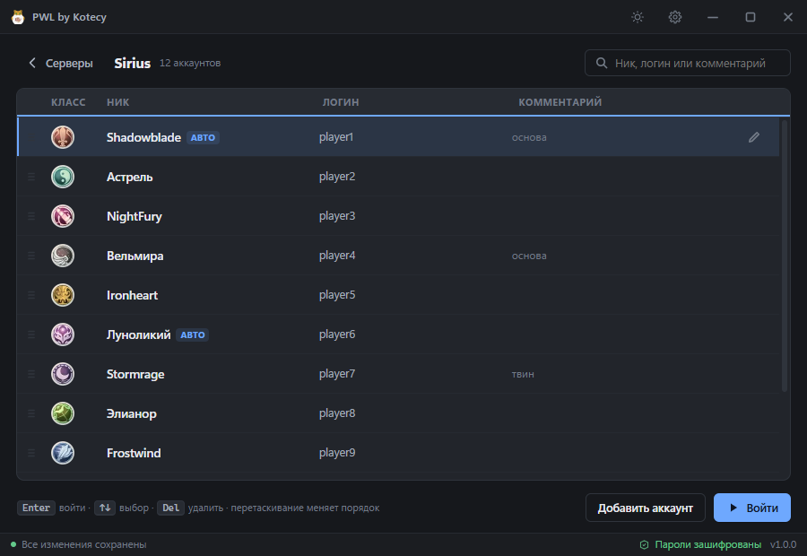

## PWL 1.0.0

Менеджер аккаунтов Perfect World переписан с нуля: вместо Python и pywebview теперь Rust и Tauri 2. Приложение — один файл около 5 МБ: устанавливать ничего не нужно, окно открывается сразу, а в простое оно занимает порядка 30 МБ памяти.

### Скачать

| Файл | Для кого |
| --- | --- |
| `PWL_1.0.0_x64.exe` | Windows 10 и 11, 64 бита. Готов к работе: положите в любую папку и запустите. Права администратора не нужны |

> [!NOTE]
> Файл не подписан сертификатом, поэтому SmartScreen может показать предупреждение. Нажмите «Подробнее», затем «Выполнить в любом случае». Приложению нужен WebView2 Runtime, он входит в состав Microsoft Edge и на актуальных Windows уже есть.

### Что нового

**Данные и безопасность**
- Пароли шифруются средствами Windows (DPAPI) и привязаны к вашей учётной записи. В `library.json` открытого текста больше нет.
- Запись на диск атомарная: временный файл, затем замена, плюс резервная копия `library.json.bak`. Обрыв питания в момент сохранения не уничтожает библиотеку.
- Повреждённый файл больше не заменяется молча пустой библиотекой: данные восстанавливаются из копии.
- Вход в игру запускает `elementclient.exe` одним процессом, без временных `.bat` с паролем в `%TEMP%`. Пробелы и спецсимволы в логине, пароле и нике больше ничего не ломают.
- Строгий CSP: ни встроенных скриптов и стилей, ни внешних ресурсов.

**Работа со списками**
- Виртуальный список аккаунтов остаётся плавным и на сотнях записей.
- У серверов и аккаунтов стабильные идентификаторы: перетаскивание строк больше не приводит к правке или удалению не того аккаунта.
- Поиск по серверам и аккаунтам, горячие клавиши `Ctrl+N`, `Ctrl+F`, `Ctrl+T`, стрелки, `Enter`, `Delete`, `Esc`.
- Ошибка запуска игры показывается в интерфейсе: нет клиента, не найден `elementclient.exe`, отказ системы.

**Интерфейс**
- Новый минималистичный дизайн, светлая и тёмная темы.
- Смена темы раскрывается волной от кнопки.
- Двадцать новых эмблем серверов в духе Perfect World.
- Иконки классов собраны в два спрайта, а не 36 файлов.
- Папка данных в настройках открывается одним кликом.

### Исправления
- Ник, логин и комментарий с символами `<` и `&` больше не ломают вёрстку и не исполняются как HTML.
- «Удалить сервер, но оставить аккаунты» теперь действительно оставляет аккаунты: они переносятся на сервер «имя — аккаунты». Раньше они пропадали в недоступном разделе.
- Убран нерабочий способ запуска «Авто ввод» вместе с настройкой.

### Обновление с 0.9.x
Замените старый файл новым и запустите. При первом запуске библиотека из `%APPDATA%\PWL` подхватывается автоматически, пароли сразу шифруются. Файлы старой версии не изменяются, поэтому при желании на неё можно вернуться.

Подробный список изменений: [CHANGELOG.md](https://github.com/Kotecy/PWL/blob/main/CHANGELOG.md).
